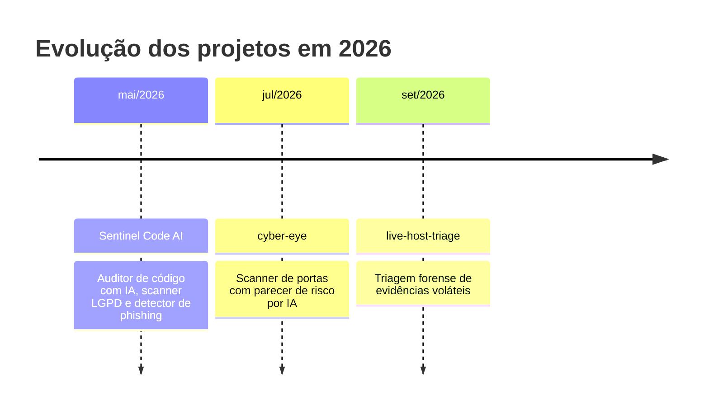

  

  
  
  

---

## Sobre

Estudante de Engenharia de Software (UniCesumar, EAD) com foco em segurança da informação. Construo ferramentas em Python para análise de código, diagnóstico de redes e resposta a incidentes, e documento cada projeto com README e histórico de commits.

Busco estágio em TI (desenvolvimento, segurança, infraestrutura e suporte).

---

## Projetos em destaque

<table>
  <tr>
    <td width="50%">
      
    </td>
    <td width="50%">
      
    </td>
  </tr>
  <tr>
    <td width="50%">
      
    </td>
    <td width="50%">
      
    </td>
  </tr>
  <tr>
    <td width="50%">
      
    </td>
    <td width="50%"></td>
  </tr>
</table>

### Visão geral

| Projeto | Área | O que faz | Tecnologias |
|---|---|---|---|
| [live-host-triage](https://github.com/natantadeu58-alt/live-host-triage) | DFIR | Coleta evidências voláteis (processos, rede, ARP, persistência) antes do desligamento de um host e gera relatório com SHA-256 | Python (biblioteca padrão) |
| [sentinel-code-ai](https://github.com/natantadeu58-alt/sentinel-code-ai) | AppSec | Kit de 4 ferramentas: auditor de código com IA (SAST), scanner LGPD, detector de phishing e extrator de logs | Python, Groq API, Regex |
| [cyber-eye](https://github.com/natantadeu58-alt/cyber-eye) | Segurança de redes | Scanner de portas TCP com parecer de risco gerado por IA | Python, sockets, Groq API |
| [devsecops-pipeline](https://github.com/natantadeu58-alt/devsecops-pipeline) | DevSecOps | Pipeline que detecta senha estática e dependência vulnerável a cada alteração de código | GitHub Actions, Bandit, Safety |
| [purple-team-command-injection](https://github.com/natantadeu58-alt/purple-team-command-injection) | Purple Team | Simulação de Command Injection em APIs e implementação das mitigações | Python |

### Linha do tempo

---

## Competências

  

- **Linguagem e automação:** Python, Shell Scripting, Expressões Regulares
- **Segurança:** OWASP, SAST e SCA, DFIR, LGPD, DevSecOps, Purple Team
- **Sistemas e redes:** Linux, Windows, TCP, ARP, análise de logs
- **Em estudo:** CompTIA Security+, AWS Cloud Security e Go

---

## Estatísticas do GitHub

  
  

  

  

